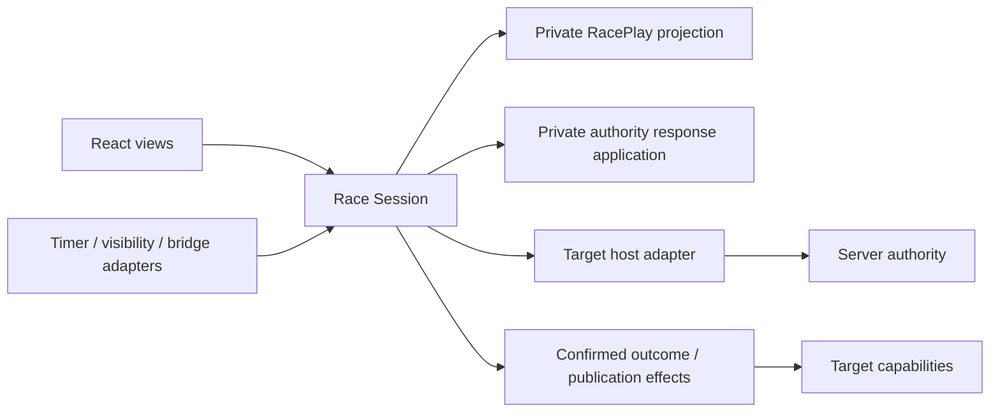

# Race Session and invitation architecture

The multiplayer client now has one Race Session module that owns the player journey. React subscribes to its immutable snapshot and delivers browser events; platform adapters retain identity, native dialogs, sharing and provider standings. Changing account, language or incoming challenge starts a new lifetime and invalidates outstanding receipts and discovery results.

## Ownership

`RaceSession` owns entry, navigation, prepared/ready/scheduled transitions, monotonic countdown recovery, input, authority reconciliation, invitation polling, abandonment and publication intent. Its public interface is the test surface. `RacePlay` is its private projection and correlated-delivery implementation. `RaceSessionAuthority` validates authority payloads before checkpoint consumption and applies complete state transitions. `useRaceSession` only connects the module to React, bridge delivery, timers and browser visibility.

Outcome reconciliation pins confirmed terminal score, timing, penalty splits and
competitive result independently of provisional deadline presentation. Active
snapshots establish minimum progress, allowing another tab's unseen completion;
subsequent result reads retain the accepted race facts while allowing reward
presentation metadata to change. Opponent timing and timeline remain immutable
through resume, while account deletion may anonymize their display identity.

Server command acceptance retains a private clock floor for every accepted mutation,
including wrong guesses. Reordered transaction attempts, scoring, settlement and
read recovery resolve their sampled time against that floor and historical scoring
events. The start and absolute deadline remain fixed. Exact request replays retain
their first response without moving current authority or charging again. Full-score
storage validation rejects finishes preceding their own accepted action history;
incomplete deadline losses retain the engine's legitimate terminal clamp.

Receipt-backed server commands retain a versioned operation/input digest in the
same transaction as acceptance. Reusing an ID with different intent fails before
mutation; matching owner and digest do not authorize a corrupt response. Supported
historical receipts prove their recoverable intent through the owned immutable run,
strict operation response and reservation. Every new accepted fallback/publication
alias also gets a receipt, without resetting starts or repeating grants. Mutation
responses are validated before commit so an undeliverable projection rolls back
staged penalties, rewards and durable delivery writes. Start replay resumes current
authority and can project evaluation afresh. See
[the request binding evidence](evidence/multiplayer-request-receipt-binding.md).

Canonical run and recording readers also bind known event history to retained
progress, owned questions, charged penalty types and accepted clocks. Archived and
opponent timelines must fit their immutable finish. Authored graphemes and immutable
rules bound known hints. Supported empty/prefix legacy history and older non-clearing
skips remain valid; missing historical facts are not reconstructed. Deadline workers
quarantine inconsistencies and validate repair before replay. See
[the timeline authority evidence](evidence/multiplayer-timeline-authority.md).

`RaceTo10Game` now renders the snapshot and supplies platform effects. The former operation-lifecycle hook and unused runtime hooks were removed. Existing Race Projection behaviour and ADR-0004's immutable answer exposure policy are retained; only the server scores races.

Authority responses must match both operation and request ID, then pass payload, run and language checks. Rejection restores input, run and its original receipt clock. Confirmation retains successor drafts. Completion and publication effects occur once, after confirmed scoring; late outcomes cannot restore a previous run after rematch.

Recorded matchmaking keeps one search request and its exact language/category preferences inside the current session lifetime. A transport failure retries the same request ID after a bounded monotonic delay; empty, exhausted, expired, consumed or changed-eligibility searches explicitly rotate the ID. Account, language, entry and navigation changes invalidate the retained request. A minimal account-scoped recovery journal retains search intent and preparation receipts across reloads. Reentry revalidates the selected challenge or owned run with server authority; hints never authorize acceptance themselves. The backend offer remains requester-bound, short-lived and replayable within its validity.

Provider adapters preserve validated failure reason, recovery and retry delay instead of interpreting error messages. Generic API throttling retains the same request; explicit bounded-search exhaustion requests a new intent. Access/invalid-request failures disable Retry. Response shape, language and selected category are checked before navigation. Recovery messages are translated in all 17 locales, and discovery controls are disabled while the session owns another pending command.

Paid-action checkpoints include answer letters, prior guess history and the selected slot. A projected hint merges newly revealed positions into the existing draft; it does not erase other letters. A projected skip starts a fresh question. Rejection of either action restores the entire original draft and receipt clock, including when the returned run identity is wrong. Authority-confirmed hints retain unrevealed draft letters and skips retain their authoritative advancement.

Retry during a race reads the owned run through `resumeRace`; it does not repeat a paid
mutation. If the question remains the same, recovery retains the draft and known guess
history, merges newly authoritative hints and moves selection away from revealed slots.
If the server already advanced after a lost skip confirmation, recovery starts a fresh
draft for that question and updates the displayed clock in the same transition.
Temporary recovery failure retains the race, original clock
anchor, input and resume hint so another refresh remains possible. Result retry and
prepared-run readiness retain their existing dedicated commands.

Resume-hint cleanup carries both account and expected run identity. Completion,
abandonment and failed startup resume clear only that run's hint, preserving a newer
hint saved by another tab for the same account. Account-wide cleanup can still omit
the expected run, and a hint remains an input to authenticated server recovery.

## Invitation lifecycle

Claim and publication are independent facts. `getRaceEntry` returns typed `waiting`, `ready`, `expired`, `cancelled` or `unavailable` responses. Invitation views expose role and cancellation capability without account IDs. The client no longer uses provider ID prefixes or error-message text to decide readiness.

The server normalizes legacy records using recipient ownership, publication timestamps and canonical recording existence. Recipient entry claims the exclusive seat transactionally; creator recovery never claims that seat. Both publication-before-claim and claim-before-publication remain valid. Blocks, account-deletion tombstones, provider scope, locale, expiry and cancellation are checked before entry.

Waiting clients use bounded exponential backoff with jitter, pause refreshes while hidden and refresh immediately on visible recovery. Expiry uses authority time anchored to the monotonic receipt clock. A delayed pre-expiry read cannot revive an expired lifetime.

`cancelRaceInvite` is creator-only and requires a target-bound idempotency receipt. It retains claim/publication facts and revokes future invitation entry. It does not modify already-issued run snapshots or scored history. Cancelling a provider share dialog for a reusable public challenge remains independent of invitation cancellation.

## Target adapters and rollout

Firebase targets expose the additive entry and cancellation callables. Reddit exposes entry through its same-origin Devvit gateway and continues to omit unsupported reservation/cancellation capabilities. YouTube, Netflix and Yahoo remain self-contained and exclude multiplayer/provider SDKs.

Deploy the additive backend callables before publishing the updated multiplayer clients. Legacy challenge-preview and claim contracts remain available; independent facts normalize existing invitations without a bulk migration. No deployment was performed as part of this refactor.

## Verification

- Public Race Session tests cover ownership changes, stale discovery, countdown recovery, close-during-start, rollback, successor drafts, duplicate/wrong-run receipts, rematch, confirmed effects, polling, visibility, cancellation and delayed expiry responses.
- Firestore emulator tests exercise real publication and acceptance in both invitation orderings, concurrent exclusive claims, creator recovery, cancellation replay/authorization, expiry, blocks, deletion, malformed records, cancelled publication and continued play of an issued run.
- Injected browser tests cover the multiplayer journey, delayed paid operations, rejected guesses, reconciliation retry, quitting, typed invitation waiting/cancellation and visibility recovery.
- All six platform builds and artifact isolation audits pass. Core, portal, backend and Reddit tests, type checks, backend lint, security, module-cycle and file-size checks pass.
- The repository-wide TSDoc audit still reports undocumented declarations in other concurrent changes. No new session or invitation declaration is reported by that audit.

## Final development verification

The original architecture requirements and current session ownership are verified in [the final development audit](evidence/multiplayer-architecture-final-audit.md). Earlier verification bullets above describe prior checkpoints; the final audit records the current gates and their limits.
