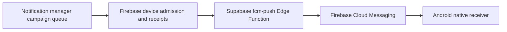

# Supabase FCM delivery

The notification manager uses the existing campaign queue, scheduler and delivery receipts. Firebase admits each account-owned device after checking current ownership, consent, revision, account deletion and expiry. Admitted native Android campaigns are sent through the Supabase `fcm-push` Edge Function to the Firebase Cloud Messaging HTTP v1 API. The native service owns display and taps.

This adapts [Supabase's FCM guide](https://supabase.com/docs/guides/functions/examples/push-notifications?platform=fcm) to the existing account and campaign model. It does not add another profiles table, notification queue or insert webhook. An additional webhook would bypass campaign admission and risk duplicate sends.

## Production configuration

The manager uses Supabase project `vqyjgcqyudqonfhgymoy` and Firebase project `riddle-quest-ec2b2`. The authenticated `fcm-push` function exchanges `FCM_SERVICE_ACCOUNT_JSON` for an FCM-scoped access token. The service account has the project permission `cloudmessaging.messages.create`. Firebase's dispatch function authenticates with `NOTIFICATION_FCM_EDGE_SECRET` and calls the configured `NOTIFICATION_FCM_EDGE_URL`. Neither credential belongs in a client build.

The Edge Function accepts an Android campaign data envelope and sets the FCM package restriction to `com.roobsworld.riddlequest`. An unsigned health request returns 401. Authenticated health returns the approved project ID after obtaining a Google access token. Health makes no device send.

Supabase's queue, admission and registration functions exclude browser installations. The manager UI can still run in a browser to manage campaigns. Device display and taps occur in the native app.

## Release history

The [native backend verification](evidence/native-notification-backend-2026-11-26.json) records the deployed Firebase and Supabase versions, authentication checks and rejection of browser payloads. The [earlier FCM activation](evidence/supabase-fcm-activation-2026-11-26.json) included browser enrollment, which the native-only rollout retired. The [preparation record](evidence/supabase-fcm-preparation-2026-11-25.json) includes the sender's successful validation-only request. See [Firebase enrollment](firebase-enrollment.md) for current account and device ownership.
