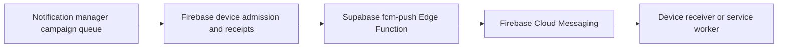

# Supabase FCM delivery

The notification manager uses the existing campaign queue, scheduler and delivery receipts. Firebase admits each account-owned device after checking current ownership, consent, revision, account deletion and expiry. Admitted Android campaigns and browser FCM registrations are sent through the Supabase `fcm-push` Edge Function to the Firebase Cloud Messaging HTTP v1 API. The receiving native service or browser worker owns display and taps.



This adapts [Supabase's FCM guide](https://supabase.com/docs/guides/functions/examples/push-notifications?platform=fcm) to the existing account and campaign model. It does not add another profiles table, notification queue or insert webhook. An additional webhook would bypass campaign admission and risk duplicate sends.

## Source and compatibility

- `notification-manager/supabase/functions/fcm-push/` owns the Edge Function, pinned Deno dependencies and lockfile.
- `src/notifications/contracts/fcmDelivery.ts` defines the validated server request and bounded outcome contract used by both runtimes.
- `firebase-functions/src/notifications/fcmEdgeDelivery.ts` makes one authenticated request with no send retry. Firebase retains durable per-device receipts across uncertain outcomes.
- Firebase owns raw FCM tokens and Web Push subscriptions. Supabase installation records retain opaque device references. The Edge Function receives an admitted token transiently and does not persist or log it.
- `notification-manager/src/fcmEnrollment.ts` obtains browser FCM tokens on the manager's enrollment page. It imports only Firebase app and messaging, without Firebase account sign-in. Game artifacts receive no messaging SDK or response listener.
- `notification-manager/public/push/worker.js` accepts legacy Web Push messages and data-only FCM messages. Both pass the same local gate, live consent check, revision check, deduplication and expiry check before display.

Existing Web Push devices continue using their current subscription and VAPID key. A fresh pairing can register a new browser through FCM when its public configuration is enabled. Unsupported browsers continue using standards Web Push. An FCM setup failure is reported; it does not silently change an existing device's delivery route. Token or account routing changes require a fresh pairing. Device registrations retain their existing 30-day expiry and manager-page renewal behavior.

## Required configuration

Use Supabase project `vqyjgcqyudqonfhgymoy`, Firebase project `riddle-quest-ec2b2` and the existing manager at `https://riddle-quest-admin.vercel.app`.

| Runtime | Setting | Purpose |
| --- | --- | --- |
| Supabase Edge secrets | `FCM_SERVICE_ACCOUNT_JSON` | Dedicated Google service-account credential for the approved Firebase project |
| Supabase Edge secrets and Firebase Secret Manager | `NOTIFICATION_FCM_EDGE_SECRET` | Matching random 32-byte base64url server credential, 43 characters without padding |
| Firebase Functions environment | `NOTIFICATION_FCM_EDGE_URL` | `https://vqyjgcqyudqonfhgymoy.supabase.co/functions/v1/fcm-push` |
| Firebase Functions environment | `NOTIFICATION_FCM_WEB_CONFIG` | JSON public browser Firebase settings with `apiKey`, `appId`, `projectId`, `messagingSenderId` and `vapidKey` |

The Google service account needs only `cloudmessaging.messages.create` in `riddle-quest-ec2b2`. Use a dedicated custom IAM role and service account. Keep its JSON credential in server secret storage. Never commit a `service-account.json` file or expose it in `VITE_` variables. See [Google's FCM authorization guide](https://firebase.google.com/docs/cloud-messaging/send/v1-api) and [Supabase Edge secrets](https://supabase.com/docs/guides/functions/secrets).

The public browser configuration must identify project `riddle-quest-ec2b2`, sender `329028367192` and its registered web app. Its VAPID public key must belong to a pair generated in or imported into that project's Firebase Cloud Messaging settings. The existing standards Web Push key is independent. Preserve it for current subscribers. See [FCM web credentials](https://firebase.google.com/docs/cloud-messaging/web/get-started).

The Edge Function disables the Supabase JWT gateway because it authenticates its dedicated server bearer itself. It rejects browser Origin headers and has no CORS allowance. Supabase publishable keys and operator sessions do not authorize sending. Requests cannot choose an FCM host or project. FCM messages contain data only, with no auto-display notification payload.

## Release order

1. Confirm `main`, review and commit the integration, then push `origin/main`.
2. Check the connected Supabase project and existing Edge Functions. Configure the dedicated Google credential and matching server bearer privately. Do not rotate existing notification-manager bridge credentials.
3. Deploy only `fcm-push`. With Supabase MCP, provide the entrypoint, `google.ts`, `deno.json`, `deno.lock` and the shared FCM contract with their relative paths; set `verify_jwt: false`. The canonical CLI fallback is pinned Supabase CLI 3.2.0, with `--workdir notification-manager functions deploy fcm-push --remote=vqyjgcqyudqonfhgymoy --use-api --yes`. Do not use `--prune`.
4. Verify its deployed source/version and its authenticated `/functions/v1/fcm-push/health` response. Health exchanges the Google credential for an FCM-scoped access token without sending a notification. The unsigned request must be rejected. Do not publish tokens, request headers or provider error bodies in evidence.
5. Set the Firebase Edge URL and secret, configure the associated public browser FCM settings, then deploy `notificationBrowserBridge`, `dispatchFirebaseNotification` and `dispatchAndroidNotification`. Keep the current queue and scheduler enabled; do not create a second sending job.
6. Build and deploy the manager to its existing Vercel project after the backend accepts `configuration-fcm` and `enroll-fcm`. Preserve disabled automatic Git deployments.
7. Inspect the live public configuration through the manager broker, the worker asset and the admitted transport settings. Check server logs for bounded errors. A device display check requires a real enrolled device and explicit authorization to send to it. No bulk campaign is part of setup.

No game client change or game build is needed for this transport release. A manager build does not trigger a Jest upload. If a later change creates a Jest game build, follow the standing Jest upload and activation instruction.

## Static verification

Run from the repository root:

```sh
pnpm dlx deno@2.9.6 check --frozen --config notification-manager/supabase/functions/fcm-push/deno.json notification-manager/supabase/functions/fcm-push/index.ts
pnpm --dir firebase-functions build
pnpm build:notification-manager
pnpm check:functions-layout
```

Use Node.js 22 for the Firebase build and Node.js 24 for the manager. Tests and browser harnesses run only when the user explicitly requests them. A successful build does not prove that hosted configuration or deployment exists.

## Current rollout

Implementation commit `487bffd7cb5806afc52c449b826d8d2c5789c2da` is pushed to `origin/main`. The Deno check, Firebase Node.js 22 build and lint, manager production build, full Vercel production build and Functions layout audit passed on November 25, 2026. No automated tests or browser harnesses ran.

Google service account `notification-fcm-sender@riddle-quest-ec2b2.iam.gserviceaccount.com` has the dedicated project role `notificationFcmSender`, containing only `cloudmessaging.messages.create`. Version 1 of both `FCM_SERVICE_ACCOUNT_JSON` and `NOTIFICATION_FCM_EDGE_SECRET` is stored in Google Secret Manager. The service-account credential was verified through the canonical Google-auth module with an FCM HTTP v1 `validate_only` request. Google returned HTTP 200 and no notification was sent. Temporary credential files were removed. The approved Edge URL is configured in the ignored local Firebase environment file.

Supabase MCP could not refresh its OAuth token, and Supabase CLI had no saved access token. The MCP service itself was reachable with the expected unsigned HTTP 401. Google Cloud and the correct Vercel project were accessible through their existing CLI logins. No Edge Function, Firebase revision, Vercel release or browser FCM VAPID setting has been changed. Complete the release order after Supabase authentication and the Firebase Web Push certificate are available. Recover the two prepared credential values privately from Google Secret Manager for Supabase secret configuration; do not generate or rotate another pair.

See the [preparation evidence](evidence/supabase-fcm-preparation-2026-11-25.json).
