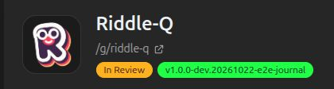

# Hosted Jest verification resumed, 23 October 2026

The user asked to load the corrected build from Jest. The Console Versions page's Preview action successfully launched `1.0.0-dev.20261022-e2e-journal`, ID `01a16583-80fa-760e-9771-4b82d849bf15`. The existing Sandbox User's server-backed Classic STAPLER and 5,110 coins restored. This continues the [compiled-artifact verification](jest-e2e-2026-10-22.md) without rebuilding or changing the uploaded package.

The fresh identity preflight at 00:58:26 BST returned HTTP 204 with the correct CORS response. The previous immediate Google Frontend HTTP 500 no longer occurred in this check. The first Simulator purchase-recovery attempt still failed its 15-second deadline: its preflight took 16.456 seconds while a new instance started. The response was 204, not 500, and no purchase POST was sent before the timeout. An explicit Retry after warm-up completed the pending purchase. Both the cold failure and recovery are retained; this is not a claim that every cold startup completes within ten seconds. No backend, billing, capacity or IAM settings were changed.

## Actual hosted Preview

- The visible typed S survived a browser reload followed by reopening the exact version through Console Preview. The native multi-character input attempt displayed only S before reload, so no recovery claim is made for letters that were not visibly committed.
- Virtual keys produced STA. Opening Settings and Help preserved the draft. Help's dialog client height and scroll height both measured 422 pixels; Got It remained fully visible. The actual Jest shell was visually inspected.
- A confirmed Hint locked P in position four and debited exactly 25 coins, from 5,110 to 5,085. Closing and reopening through Console Preview restored STA, the locked P and the current 5,085-coin wallet.
- Completing STAPLER through the visible keyboard produced a 35-coin receipt: 25 Classic plus 10 achievement coins. The wallet became 5,120 and XP became 700. Next was usable and advanced to a playable PENGUIN riddle.

## Official review Simulator

The exact journal version passes all 20 Basic Launch checks. The replacement review was submitted successfully with the optional Fund application unchecked.

- Startup recovered one incomplete mock purchase for 7,000 coins. With the existing initial and first-purchase amounts, the displayed wallet was 7,325.
- Guest onboarding, the combined Register / Login overlay and simulated registration completed without real SMS. All seven notification days were covered; the first callback was scheduled three seconds after registration.
- Cancelling coin pack 2 left 7,325 unchanged. Completing its mock checkout added exactly 550, making 7,875.
- Mock Premium activation added 3,400, making 11,275. Reopening the shop showed Premium active with no Subscribe offer.
- Virtual keys visibly produced TOA. Immediately selecting the Simulator's native Reload app action restored all three letters, cursor position and the unchanged 11,275 wallet.
- Request screenshot returned an image in the Console. Its data image was visibly present. No media download was attempted.

These Simulator transactions use the official mock checkout. Actual hosted Preview and Simulator observations are distinguished from the earlier mocked-provider compiled browser suites. The existing 79 browser checks, 337 bounded navigation routes, 3,335 unit tests and seven target builds remain tied to the same immutable uploaded package. No additional full test run was needed because game source and package bytes were not changed.

Fresh sanitized server evidence is under `artifacts/jest-e2e-2026-10-23/hosted-resume/`. Historical failures remain under the previous date's evidence.

## Final release state

Update pending submission completed at 01:10:15.860 BST on 23 October 2026 under `grindheadgames@gmail.com`. The official connector confirms the exact journal version is processed, active and In Review, with review ID `01a1629d-0471-72b7-8239-e7461610efbc`. Its `approvedAt` remains null and `isPublished` remains false. Human approval is pending; this is not public publication. The earlier failed candidate remains inactive.

The review notes include the 20 Simulator passes, compiled/source checks, hosted recovery, reward progression and initial cold-preflight limitation. No legal terms were accepted, no real payment or SMS was performed, and no backend or capacity deployment occurred. The screenshot provider's returned data image was not downloaded. A separate browser screenshot of the visible Console status was saved with SHA-256 `08112c4c31886f33b99b5d7199f33d7a39390baa38a3bee0796cc0633e35ac93`.

The [version-pinned test link](https://jest.com/g/riddle-q?versionId=01a16583-80fa-760e-9771-4b82d849bf15) was loaded using the Console's Preview button. The game and review tabs remain open. [Official release readback](../../artifacts/jest-e2e-2026-10-23/hosted-resume/release-summary.json) records the exact active/in-review version.
