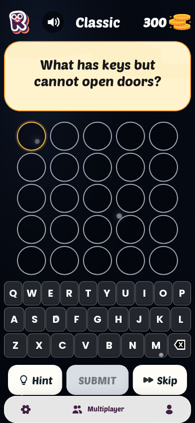
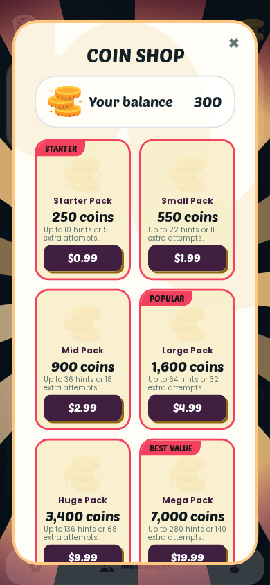
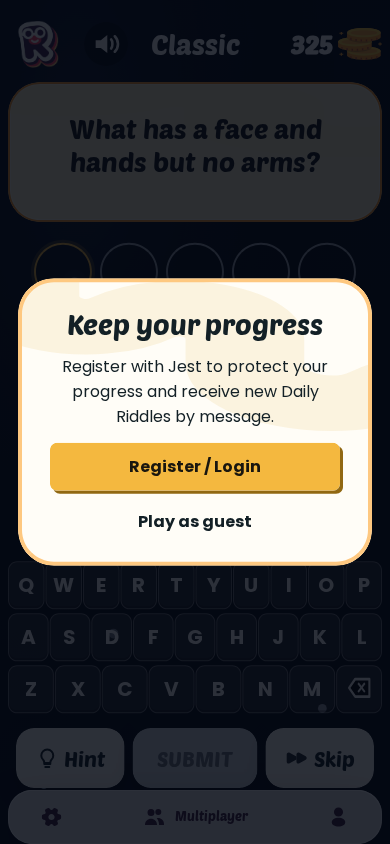

# Real screenshot capture, 25 October 2026

The reviewer attached a generated text card in place of a screenshot. The previous provider painted a fixed 1200 by 630 gradient and concatenated game text. A focused browser reproduction failed because its 1200-pixel image did not match the 390-pixel game viewport.

The provider now captures the visible isolated app viewport with the bundled `html2canvas-pro` 2.5.2 renderer. It includes game dialogs, multiplayer and the sibling Jest registration prompt. It waits for fonts and uses the renderer's bounded five-second image-loading stage, preserves scroll positions, excludes password and hidden inputs and elements marked private, and clips offscreen content. It reduces actual image pixels when needed to fit Jest's 2 MiB complete PNG data URL limit. Capture failures return null. The outer wrapper now awaits asynchronous capture so rejections reach that existing fallback.

The renderer loads through the existing lazy screenshot chunk when Jest requests a capture. Its dependency declaration permits it only in the Jest artifact. Other platform target allowlists are unchanged. Its MIT notice is included. There are no new runtime backend requirements or screenshot CDN scripts.

## Focused verification

Thirteen unit checks, the portal TypeScript check and the Jest-only dependency boundary check pass. The exact compiled callback passes twenty Chromium and nineteen applicable WebKit screenshots at 390 by 844 and 1280 by 900: game card, keyboard, multiplayer, shop, scrolled shop, profile, settings, victory, registration prompt and loss. Eight DOM fixture cases per engine verify viewport dimensions, exact asset/scroll/modal pixels, failed-avatar fallback, and absence of hidden, private and offscreen pixels. Chromium is muted and media is blocked before navigation. The default newer WebKit package lacks its system `libevent` dependency. The existing BeeHive Playwright 1.61.0 package and its matched cached WebKit 2311 work without installing another browser or overriding library paths. That engine passed all nineteen applicable actual-app cases and all eight fixtures. Its desktop shop fits the viewport, so the conditional desktop scrolled-shop case does not apply. These are WebKit engine checks, not physical Safari device tests.

The real-app comparison samples visible screen regions against native browser screenshots. Its gate requires more than 80 percent of sampled pixels within 12 RGB levels per channel on average and mean per-channel difference below 20. The first-capture custom-font game region matches 99.855 percent on mobile and 99.939 percent on desktop. Other screen comparisons allow normal rasterization and shadow differences. These checks use mock gameplay data and do not establish real commerce or messaging delivery.

The DOM-to-SVG prototype preserved layout but lost custom fonts. The original html2canvas prototype rendered those fonts but mispainted current CSS shadows. Both failed the same visual gate and were removed from direct dependencies. The selected maintained renderer passes the font, layout and scroll checks without those substitutions.

A final narrow correction removes a redundant unbounded image decode wait and leaves resource loading to the renderer's five-second timeout. All thirteen unit checks and all eight loaded-asset, failed-avatar, privacy and scroll fixtures passed after that correction. The subsequent exact compiled callback checks pass after that correction.

The final exact compiled callback is `assets/captureGameScreenshot-s8gyYdL6.js`. It passes twenty Chromium and nineteen WebKit actual-app cases. Source-provider fixtures add eight passes per engine, for fifty-five browser cases. Upload, activation and official Simulator verification belong to the release follow-up and are not claimed by this record.

The first exact compiled run exposed a test timing mismatch on loss. Its PNG correctly showed the pending loss modal without Close, while the later native reference showed the acknowledged modal with Close and different title wrapping. The test now waits for that actual Close affordance before comparing the same acknowledged state. WebKit similarly exposed the first profile tour starting between capture and reference; the returning-player fixture now marks that versioned tour complete. No runtime change, arbitrary delay or weaker pixel threshold was introduced for either correction.

Repeat with `node packages/portal/scripts/verify-jest-screenshot-fixtures.mjs` and `node packages/portal/scripts/verify-jest-screenshot-browser.mjs`. The latter accepts `PORTAL_JEST_BUILD_DIR`, `JEST_SCREENSHOT_REPORT_DIR` and `JEST_SCREENSHOT_CAPTURE_MODULE`. Both scripts accept `JEST_SCREENSHOT_BROWSER=chromium|webkit` and `JEST_SCREENSHOT_PLAYWRIGHT_MODULE` for an existing matched Playwright installation. Set the last to the relative built capture chunk to verify that compiled callback instead of the source callback.

[Detailed results](jest-screenshot-feedback-2026-10-25-results.json).

## Later release readiness readback

[The current completion record](../../common/web-game/evidence/completion-readback-2026-10-25.md) supersedes this note's release status. The screenshot fix is already uploaded, Ready and active as version `01a17226-db08-708f-86a1-6733b1fe4824`. All 419 hosted files match. The official Simulator now passes all 20 Basic Launch checks after an ordinary reload recovered the blank frame. Review submission and publication remain separate; no submission is claimed.
