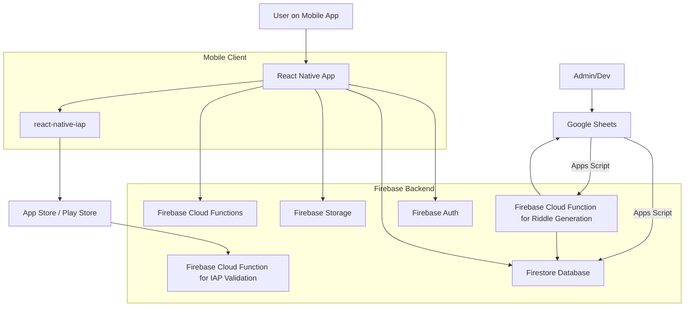

# System Patterns: Riddle Wordle Clone

## 1. System Architecture Overview

The system follows a client-server architecture:

- **Client:** React Native mobile application (iOS and Android) responsible for UI, user interaction, game logic execution, and communication with the backend.
- **Backend:** Firebase services providing authentication, database (Firestore), file storage (Firebase Storage), and serverless functions (Firebase Cloud Functions).
- **External Integration:** Google Sheets (via Google Apps Script) for initial riddle data management and synchronization.

## 2. Key Technical Decisions & Design Patterns

- **Cross-Platform Development:** React Native is chosen for its ability to target both iOS and Android with a single codebase, accelerating development.
- **Serverless Backend:** Firebase is adopted to minimize backend infrastructure management, leveraging its PaaS/BaaS capabilities for auth, DB, storage, and functions.
- **Component-Based UI:** React Native promotes a component-based architecture for the UI, enhancing reusability and maintainability. We are actively creating reusable components, starting with `ReusableTextInput`.
- **Styling with Utility Classes:** NativeWind (Tailwind CSS) will be used for styling, promoting rapid UI development and consistency through utility-first classes.
- **State Management:**
  - **Local/Component State:** React's built-in `useState` and `useReducer` for component-level state.
  - **Global State:** React Context API for simpler global state needs (e.g., theme, user authentication status). Zustand may be considered if state logic becomes complex and requires more performance or a more structured approach outside of React's component tree.
- **Data Flow:** Primarily unidirectional data flow within the client application, typical of React applications.
- **API Communication:** Asynchronous requests (e.g., using `fetch` or a library like Axios) from the client to Firebase services.
- **Modularity:** Code will be organized into modules by feature (e.g., authentication, game, profile, settings, store) and by type (e.g., components, screens, services, hooks, types).

## 3. Component Relationships (High-Level)

- **App Navigator:** Manages overall screen navigation (e.g., Auth stack, Main App stack with bottom tabs).
- **Screen Components:** Represent individual screens (e.g., `HomeScreen`, `GameScreen`, `ProfileScreen`, `SettingsScreen`, `StoreScreen`).
- **Shared Components:** Reusable UI elements (e.g., `Button`, `Card`, `Input`, `Modal`, `GuessGrid`, `Keyboard`). `ReusableTextInput` has been created as the first of these shared input components.
- **Service Modules:** Encapsulate logic for interacting with Firebase (e.g., `AuthService`, `FirestoreService`, `StorageService`).
- **State Management Contexts/Stores:** Provide global state and actions to components that need them.

## 4. Critical Implementation Paths

1.  **Authentication Flow:** Secure user sign-up, login (Google, email/password), password reset, and anonymous login. Handling auth state changes and protecting routes.
2.  **Game Logic:** Implementing the core Wordle-style guess evaluation, riddle presentation, and state updates for both Challenge and Classic modes.
3.  **Firebase Integration:**
    - Setting up Firestore schemas for user data, game progress, and riddles.
    - Implementing CRUD operations for Firestore.
    - Integrating Firebase Storage for avatar uploads.
4.  **Google Sheets to Firestore Sync:** Developing the Google Apps Script for initial riddle population and ensuring a reliable sync mechanism.
5.  **Cloud Function for Riddle Generation:** Designing and implementing the serverless function to dynamically create new 5-letter riddles and update both Firestore and Google Sheets. This is critical for long-term content.
6.  **In-App Purchase (IAP) Flow:** Integrating `react-native-iap`, handling purchases, and implementing server-side validation via a Firebase Cloud Function.
7.  **Profile Management:** Avatar selection/upload, stats display, and persistence.
8.  **UI Styling and Responsiveness:** Ensuring the app looks and feels consistent with the design mockups across different screen sizes and platforms using NativeWind.

## 5. Data Models (Initial Thoughts for Firestore)

- **`users` collection:**
  - `userId` (doc ID)
  - `email` (if email auth)
  - `username`
  - `avatarUrl`
  - `xp`
  - `coins`
  - `createdAt`
  - `stats` (object: `dailyPuzzlesCompleted`, `bestStreak`, `totalWordsGuessed`, `winRate`, `averageGuesses`, `totalScore`, `highestLevelClassic`, `gamesPlayed`)
- **`riddles` collection (for Classic Mode & Challenge Mode history/pool):**
  - `riddleId` (doc ID)
  - `riddleText`
  - `answer` (5-letter word)
  - `difficulty` (optional)
  - `source` (e.g., "googleSheet", "generated")
- **`userClassicProgress` collection:**
  - `userId_riddleId` (doc ID or subcollection under users)
  - `status` ("unlocked", "solved", "skipped")
  - `attempts` (if solved)
  - `solvedAt`
- **`dailyChallenge` collection (stores the daily challenges for a given date):**
  - `date` (e.g., "YYYY-MM-DD", doc ID)
  - `riddleIds` (array of strings, each referencing a `riddleId` from the `riddles` collection, in order)
- **`userDailyChallengeAttempts` collection (tracks user progress for daily challenges):**
  - `userId_challengeDate` (doc ID)
  - `guesses` (array of guessed words) - _Note: This might need refinement to track guesses per riddle if multiple attempts are allowed per riddle within the daily set._
  - `isSolved` (boolean, indicates if the _entire_ daily challenge set for the day is completed)
  - `coinsEarned` (number, total coins earned for the daily challenge set)
  - `completedIndex` (number, the index of the next riddle to be attempted in the `riddleIds` array for the day)

These data models are initial and will be refined as development progresses.
